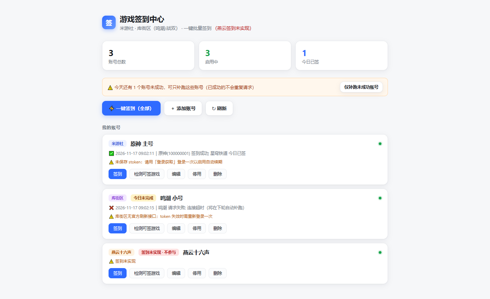
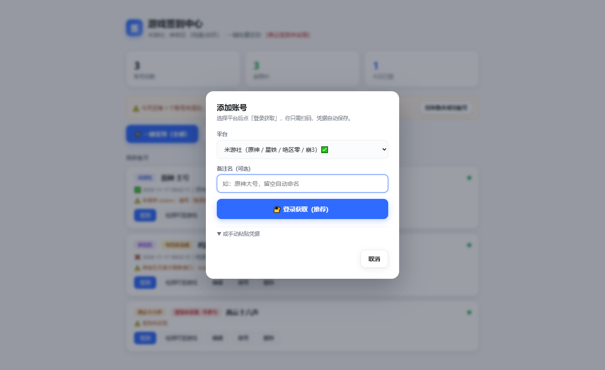

# 游戏一键签到（本地桌面版 · 加密存储 · 自动续期）

一套 Python 引擎 + 本地 Web 界面，支持多账号批量每日签到。**只监听 127.0.0.1，不对外暴露服务**。

## ⚠️ 实现状态（请先看这里）

| 平台 | 状态 | 说明 |
|---|---|---|
| 米游社（原神 / 星铁 / 绝区零 / 崩3） | ✅ 已实现 | 实机核对通过；支持 **stoken 自动续期** |
| 库街区（鸣潮 / 战双帕弥什） | ✅ 已实现 | 实机核对通过；官方无刷新接口，失效需重新登录一次 |
| 森空岛（明日方舟 / 终末地） | 🧪 已实现·测试中 | 协议/设备指纹/签名已按公开实现核对并在线验证；**尚未用真实 token 端到端验证** |
| **燕云十六声** | ❌ **未实现** | **签到不参与自动运行**，见下方说明 |
| 其他平台 | 占位 | `stub` 仅为示例 |

**森空岛（Skyland）签到说明（测试中）：**

- 覆盖游戏：明日方舟（每个绑定账号签一次）、明日方舟：终末地（每个角色独立签一次），已签角色会自动跳过。
- **Token 获取（自动）**：在「添加账号」里选森空岛、点「登录获取」，程序会打开官网登录页，你用鹰角账号正常登录后，程序自动通过页面上下文读取 `info/hg` 的 `data.content` 并保存，**无需手动复制**。登录态只留在临时浏览器 profile，程序不接触你的账号密码；浏览器登录同样基于 CDP 纯标准库实现（与库街区一致）。
- Token 获取（手动兜底）：也可展开「手动粘贴凭据」，自行登录 <https://www.skland.com/> 后访问 <https://web-api.skland.com/account/info/hg>，复制 `data.content` 的完整长字符串填入。它等同于账号凭证，请勿外泄。
- 技术：`engine/skland.py` 完成 `token → 授权码 → cred → 绑定角色 → 逐角色签到`；请求签名为 `md5(hex(hmac_sha256(cred_token, path+body+timestamp+header_ca)))`。设备指纹 `dId` 与 DES/AES/RSA 均为纯标准库实现（`engine/skland_crypto.py`），已通过 DES/AES/HMAC/RSA 标准向量自检与数美指纹服务在线验证，**无需 pip 安装 extra 加密库**。
- 边界：token 失效后没有自动续期，需按上面步骤重新取一次 `data.content`（与库街区同类）；协议参考 `kafuneri/Skland-Sign-In`、`AEtherside/skland-daily-attendance` 等成熟开源实现交叉核对。
- 状态为 `beta`（`IMPLEMENTATION_STATUS["skland"]="beta"`）：**会正常参与自动签到**，UI 会显示「测试中」标记；因作者没有真实 token，尚未端到端跑通真实签到，若遇到失败请反馈结果以便调整。

**燕云十六声签到尚未实现**，请勿当作可用功能：

- `engine/netease.py` 只是按公开资料写出的协议草稿。所谓「实机核对」仅证明 4 个端点存在、在无 token 时返回 `code:-1 未登录`，**从未用真实 `access_token` 端到端验证过**签到结果、幂等与风控行为。
- 其 `access_token` 是微信小程序令牌，网页 / 云游戏页拿不到，也没有刷新接口，无法形成可用的每日签到闭环。
- `engine/__init__.py` 已把 `yanyun` 标记为 `unimplemented`，`service.py` 会直接短路并明确告知，**不会发起签到请求、不会假装签到成功**。
- 已完成且可用的是「**唤起微信小程序**」这个辅助功能（`store/login_browser.py`）：动态检测微信客户端、从微信缓存自动发现 appid、支持粘贴小程序链接。它只用于帮用户打开小程序去抓包，**与签到能否使用无关**。

状态由 `engine.IMPLEMENTATION_STATUS` 统一管理，Web UI、`/api/platforms`、签到调度共用同一份事实来源。

## 界面预览

> 以下为程序**实际运行截图**，使用虚构演示账号，不含任何真实 Cookie / token / UID。

主界面：账号总览、今日完成情况、失败提醒横幅与「仅补跑未成功账号」入口；账号卡片会显示自动续期状态、「今日未完成」和「签到未实现」标记。



添加账号：选好平台后点「登录获取」扫码即可，凭据自动加密保存；也可展开「手动粘贴凭据」自行填写。



## 核心设计

```
    账号凭据（加密落盘）          平台协议（无状态）
    ┌──────────────────────┐    ┌──────────────────────┐
    │ store/ 存储层         │───▶│ engine/ 适配器        │
    │  vault.json (加密)    │    │  mihoyo / kuro       │
    │  主密钥持久化          │    └──────────┬───────────┘
    └──────────┬───────────┘               │
               ▼                           ▼
    ┌──────────────────────────────────────────────┐
    │ service.py：懒补齐 → 签到 → 失效时自动续期→重试  │
    └──────────────────────┬───────────────────────┘
                           ▼
                Web 界面 / CLI / 定时调度
```

| 问题 | 方案 |
|---|---|
| 凭据安全 | AES-256-GCM 加密落库（无依赖时回退 HMAC 流加密），前端永不显示明文 |
| 用户不用每次重填 | 凭据持久化 + 主密钥持久化，重启不丢 |
| **登录过期反复授权** | 米游社用 `stoken` 自动兑换新 `cookie_token` 并回写；详见「自动续期」 |
| 多账号批量 | 一个用户可挂任意多个账号，一键签到全部 |
| 新游戏不用改代码 | 库街区遍历 gameId 自动识别；米游社一次取回全部角色 |
| 部分失败不被掩盖 | 结果按游戏逐项分类，部分成功标为 `partial`，不再「有一个成功就算全成功」 |
| 当天只补跑失败账号 | 按账号×日期记 `last_ok_date`，调度器跳过已完成的账号 |
| 网络抖动不误伤 | 只对超时/断连退避重试 2 次；验证码、今日已签、参数错误绝不重试 |
| 无人值守可见性 | 首页显示「今天还有 N 个账号未成功」横幅，可一键只补跑这些账号 |

## 自动续期（重点）

**米游社（真的能自动续，登录一次可长期有效）**

- 登录时程序会结构化保存 `stoken` / `stuid` / `mid` / `device_id`（`stoken` 来自登录响应体，不是普通网页 Cookie），并加密写入账号库。
- 对历史账号，签到前会从已存 Cookie 串里**懒补齐**这些字段，只要当初的 Cookie 带 `stoken`，**无需重新登录**即可获得自动续期能力。
- 正常签到路径零额外网络请求；只有当签到返回「登录态失效」信号时，才用 `getUserGameRolesByCookie` 二次确认，然后走 `getCookieAccountInfoBySToken` 兑换新的 `cookie_token`（passport 主接口 → takumi 旧接口回退），**立即回写加密库**，稍等后自动重试签到。
- 关键约束：兑换会让旧 `cookie_token` 作废（服务端单活轮换），因此按账号加串行锁、只在确认失效时兑换、成功后必须回写。
- Web 界面账号卡片会显示「自动续期已启用 / 未保存 stoken」，也可用 `POST /api/accounts/<id>/renew` 手动检查。

**存量账号的边界（如实说明）**：如果账号是旧版本保存的、Cookie 里本来就没有 `stoken`，程序无法凭空造出 stoken，也无法凭 `ltoken` 反向兑换（官方未提供可用接口，不编造）。这种情况下只需**点一次「登录获取」扫码**，程序会保存 stoken，此后长期自动续期、不再需要重复授权；也可以在「编辑账号」里把 `stoken=...` 补进 Cookie 串，程序会自动识别。存量库街区账号同理只能靠「登录获取」重新拿一次 token。

**库街区（诚实说明，不能编造接口）**

- 对照多个开源实现，库街区官方**没有公开的 token 刷新接口**（只有「登录已过期 → 自动禁用」）。因此程序不会假装有 refresh。
- 减少重复授权的做法：浏览器登录一次后保存完整 `token` + `source=h5`（网页 token 必须配 `source=h5`，写错会导致签到失败），失效时给出一步到位的重新登录指引。
- 建议：库街区 token 失效时点「登录获取」用手机号 + 验证码重新登录一次，程序自动保存，不用手填。

## 结果分类 / 幂等补跑 / 分类重试

**为什么改**：旧版米游社、库街区适配器都用 `ok = ok or s` 汇总，只要有一个游戏或社区签到成功，
整个账号就算成功，失败项只留在文本里 —— 续期不触发、失败也永远不会被补跑。现在改为逐项记录再汇总。

| 类别 | 判定 | 程序动作 |
|---|---|---|
| `ok` / `already` | 全部成功 / 今日已签 | 记 `last_ok_date=今天`，清零连续失败，静默 |
| `partial` | 部分游戏成功、部分失败 | **不算完成**，保留待补跑状态，不立即重签已成功项 |
| `transient` | 超时 / 5xx / 连接重置 | 指数退避 1s、2s + 抖动，最多重试 2 次 |
| `auth` | 登录态失效 | 米游社走 stoken 自动续期并重试一次；库街区提示重新登录 |
| `captcha` | 米游社 1034 人机验证 | **绝不重试**，提示到米游社 App 处理 |
| `failed` | 其他确定性失败 | 不重试，累计失败次数 |

- **按账号幂等**：成功后写入 `last_ok_date`（YYYY-MM-DD）。定时调度只跑当天未完整成功的账号，
  一个账号失败不再拖累整天；开机补跑、部分失败补跑都走同一条路径。手动点「一键签到」默认强制全跑，
  首页另有「仅补跑未成功账号」按钮。
- **自动停用**：连续 2 次确定性失败才把账号置为停用，避免库街区 token 过期后每天空打接口；
  网络抖动不计入，结果文案会给出明确的重新启用提示（重新登录后手动启用即可）。
- **调度器**：`logs/scheduler_state.txt` 记录 `日期|当天轮数|上次时间戳`，两轮至少间隔 30 分钟、
  每天最多 6 轮，触发时间带 0~180 秒抖动。`--once` 配合系统 cron，`--once --force` 可强制全跑。
- **兼容**：`CheckinResult.status/items` 与 `Account.last_ok_date/fail_streak` 全部带默认值，
  旧账号库、旧适配器构造方式都能正常读取，不需要重新登录。

## 本地运行

```bash
pip install -r requirements.txt      # requests（引擎本身零依赖，仅标准库）

# 首次运行会自动生成并持久化用户级主密钥（config/master.key）
python web/server.py                 # http://127.0.0.1:8899
```

或命令行：

```bash
python local/client.py add --platform mihoyo --label 原神大号 --cookie "ltuid=...; ltoken=..."
python local/client.py list
python local/client.py checkin
python local/scheduler.py --hour 9 --minute 0    # 每天 9 点常驻
```

## 打包为 exe（Windows）

```bash
python -m pip install pyinstaller
python build_exe.py                  # 产物：dist/游戏签到中心/游戏签到中心.exe
```

- 打包后 `vault.json` 与 `master.key` 存放在 **exe 同目录 `config/`**，不会写进 PyInstaller 临时解包目录（否则重启即丢、等于逼用户重新登录）。
- exe 首次启动会生成随机主密钥并持久化；之后重启沿用同一密钥，已存账号仍可解密。
- **可通过环境变量覆盖**：`CHECKIN_MASTER_KEY`、`CHECKIN_MASTER_KEY_FILE`、`CHECKIN_VAULT_PATH`。
- 迁移旧数据：把原来的 `config/vault.json` 和对应主密钥放到 exe 同目录 `config/` 即可，账号无需重新登录。

## 数据文件与保密（GitHub 发布务必遵守）

| 文件 | 内容 | 是否可提交 |
|---|---|---|
| `config/vault.json` | 用户账号与**加密凭据** | ❌ 绝不提交 |
| `config/master.key` | 本地主密钥 | ❌ 绝不提交 |
| `logs/`、`*.log` | 运行日志 | ❌ 绝不提交 |
| `config/games.json` | 运行时自动生成的游戏表 | ❌ 不提交（可提交 example） |
| `.workbuddy/`、memory/prompt/提示词 | 工作记录，非程序本体 | ❌ 绝不提交 |
| `dist/`、`build/`、`*.spec`、`__pycache__/` | 构建与运行产物 | ❌ 不提交 |
| `engine/ store/ web/ local/ cloud/ miniprogram/ service.py` 等 | 程序本体源码 | ✅ 提交 |

发布请使用**白名单目录**（见 `prepare_release.py`），而不是直接把整个工作目录 `git add .`：

```bash
python prepare_release.py            # 生成 release/ 白名单目录 + 敏感信息扫描
```

## 各平台凭证获取

| 平台 | 字段 | 方式 |
|---|---|---|
| 米游社 | `cookie` | **推荐点「登录获取」扫码**（自动保存 stoken 启用续期）；或浏览器登录米游社后复制完整 Cookie（需含 `stoken`/`ltoken`/`ltuid`/`cookie_token`） |
| 库街区 | `token` | **推荐点「登录获取」**（官方登录页 + 手机号验证码，程序自动保存 `source=h5`）；或 App 抓包取请求头 `token` |
| 燕云十六声 | — | **签到未实现**。「小程序链接」/「登录获取」仅用于唤起微信小程序辅助抓包：支持 `weixin://dl/business/?appid=…` 直达、`#小程序://` 私有短链复制到剪贴板 + 打开微信、自动扫描微信缓存发现 appid、桌面快捷方式兜底。微信客户端动态检测，兼容 `Weixin.exe` / `WeChat.exe` |

## 目录结构

```
game-checkin/
├── engine/            # 共享签到引擎（只管平台协议）
│   ├── mihoyo.py      # 米游社（已实机核对，含 V2→V1 cookie 别名修复）
│   ├── kuro.py        # 库街区（已实机核对）
│   ├── skland.py      # 森空岛 / 明日方舟 + 终末地（测试中）
│   ├── skland_crypto.py # 森空岛签名/设备指纹：纯标准库 DES/AES/RSA
│   ├── netease.py     # 燕云十六声（⚠️ 未实现的实验草稿）
│   └── ...
├── store/             # 账号存储层
│   ├── local_store.py # 加密库 + 主密钥持久化 + 打包路径处理
│   ├── credentials.py # 凭证健康检查 / 自动续期 / 回写
│   └── login_mihoyo.py / login_browser.py
├── service.py         # 批量签到（结果分类 / 分类重试 / 幂等补跑 / 失效禁用）
├── web/               # 本地 Web 界面（标准库 HTTP 服务）
├── local/ cloud/ miniprogram/
├── app_main.py        # exe 入口
├── build_exe.py       # PyInstaller 打包脚本
├── prepare_release.py # GitHub 白名单发布目录生成 + 敏感扫描
└── tools/             # 本地自检脚本（发布时只保留回归测试）
```

## 实机核对记录（2026-11-13）

- **米游社**：4 款游戏 `luna/home` 全部 `rc=0` 返回 30 条奖励；端点 `/event/luna/sign`、盐 `DlOUwIupfU6YespEUWDJmXtutuXV6owG`、app_version `2.109.0`。修复了「能查角色但签到 -100」的 V2/V1 Cookie 名坑。
- **库街区**：修正 4 处错误 —— 头是 `token`（非 `x-token`）、端点 `/encourage/signIn/v2`、请求体需 `gameId+serverId+roleId+userId+reqMonth`、另有 `/user/signIn` 社区签到。
- **森空岛（2026-11-17）**：🧪 协议端点（grant / cred / binding / 两个签到端点）全部可达；DES/AES/HMAC/RSA 四组标准向量自检通过；数美设备指纹服务在线返回 `code=1100` + deviceId；认证链与逐项签到用 mock 覆盖（21 项）。**尚无真实 token，未端到端验证真实签到结果**。
- **燕云十六声**：⚠️ 仅端点探活（无 token 时返回 `code=-1 未登录`），**签到未做真实验证、未实现**。
- **自动续期端点**：`passport-api.mihoyo.com/account/auth/api/getCookieAccountInfoBySToken`（DS x4）与 `api-takumi.mihoyo.com/auth/api/getCookieAccountInfoBySToken`（回退），已对照公开实现核对。

回归命令：
```bash
python tools/selftest_engine.py       # 米游社常量 / V2→V1 别名
python tools/selftest_store.py        # 加密 / 隔离 / action 协议
python tools/selftest_discovery.py    # 游戏自动发现
python tools/test_credential_refresh.py  # 自动续期（纯 mock，不联网、不碰真实账号库）
python tools/test_stage_a.py          # 结果分类 / 重试 / 幂等补跑 / 失效禁用（33 项，纯离线）
python tools/test_skland.py           # 森空岛：加密向量/签名/dId/认证链/逐项签到（21 项，纯离线）
python tools/test_web.py              # Web API
```

## 风险

- 自动化签到可能触发官方风控/验证码；建议每天 1 次、只签自己账号。
- 米游社 `stoken` 本身也会在极少数情况下失效（改密、风控），届时仍需重新登录一次。
- 库街区官方无刷新接口，token 过期必须重新登录。
- 燕云签到未实现，不要依赖它。
- **主密钥丢失 = 已存凭据无法解密**（需重新登录录入）。请备份 `config/master.key`，但绝不要上传到公开仓库。
